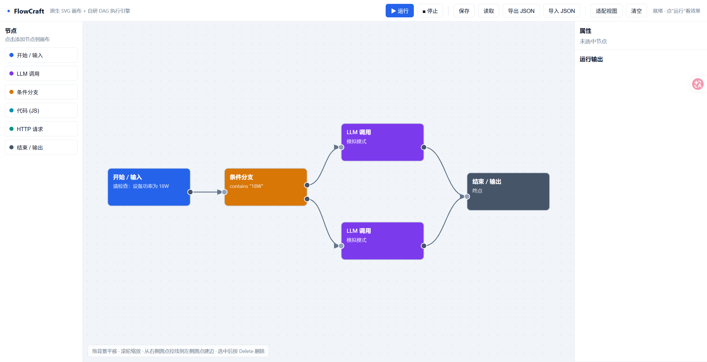
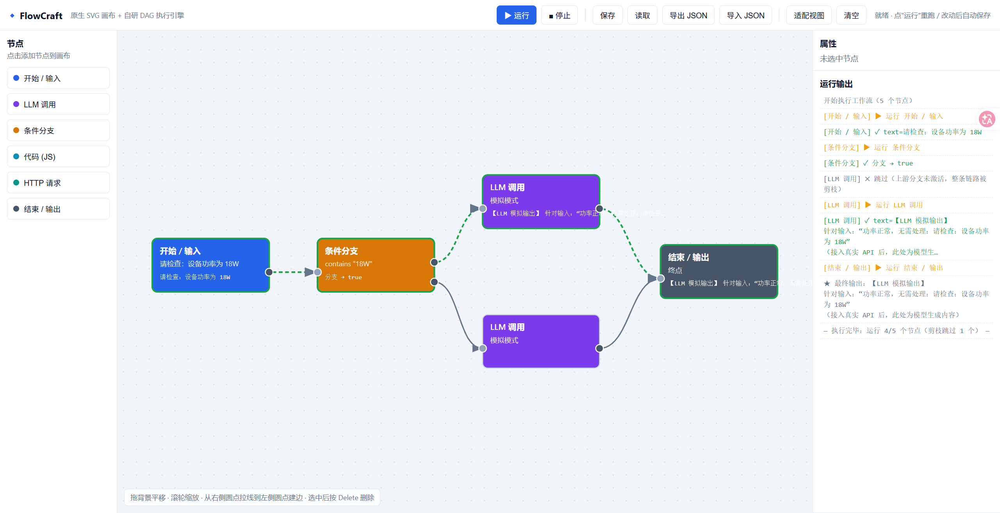

# FlowCraft · 可视化 AI 工作流编排平台

拖拽节点、连线成 DAG，点一下就把整条链路跑起来。原生 SVG 自研画布 + 自研 DAG 执行引擎，
**零前端框架、零编排库**——所有"难的东西"都是手写的，正好拿来跟面试官讲。

这是简历项目规划里的**第二个项目**（第一个是 InsightKB 企业知识库 RAG 问答）。
技术约定与第一个一致：**零框架原生 HTML/CSS/JavaScript**，不引 Vue/React。

---

## 30 秒上手

直接用浏览器打开 `index.html` 即可（双击就行，`file://` 也能跑，无需起服务）。

- 左侧点节点类型 → 画布中央出现节点
- 从节点**右侧圆点拖到另一个节点左侧圆点** → 建一条边
- 拖空白背景平移、滚轮缩放、点节点看属性、选中后按 `Delete` 删除
- 点右上角 **▶ 运行**，看节点逐个高亮、右侧输出每一步结果

打开时自带一个"功率检查"示例：开始 → 条件分支（是否含 18W）→ 两条 LLM 分支 → 汇聚到终点。

---

## 界面

| 编辑器 | 点"运行"之后 |
|---|---|
|  |  |

右图是同一个示例跑到结束的样子，注意三件事：

1. **绿色虚线**是实际走通的那条路，另一条紫色分支还停在原地没动；
2. 运行输出里那条分支是 `⨉ 跳过（上游分支未激活，整条链路被剪枝）`，不是"跑了但结果为空"；
3. 终点仍然执行了，最后一行是 `执行完毕：运行 4/5 个节点（剪枝跳过 1 个）`。

第 3 点是最容易被写错的地方：条件分支剪掉一条边之后，终点的"还差几条入边没到"如果
不跟着递减，终点会**永远等一条不会来的边**，整条流程卡死在那儿。见下方「条件合并」一节。

---

## 架构

```
index.html
├─ css/style.css          全部手写样式（无 UI 框架）
└─ js/
   ├─ graph.js    数据模型：节点 / 边 / 增删 / 序列化（与渲染、执行解耦）
   ├─ nodes.js    节点类型注册表：每个算子描述端口 + 默认配置 + run(config, inputs)
   ├─ engine.js   自研 DAG 执行引擎：拓扑排序 + 环检测 + 条件剪枝 + 多输入汇聚
   ├─ canvas.js   自研 SVG 画布：平移/缩放/拖拽/连线/选中（不引任何图编辑库）
   ├─ store.js    持久化：localStorage + 导入/导出 JSON
   └─ main.js     入口：把上面五块串起来，处理工具栏与属性面板
```

三层分离是刻意的：`graph`（数据）/ `canvas`（渲染）/ `engine`（执行）互不依赖，
各自可单测，将来要把存储换成数据库、或把执行搬到后端，都不用动另外两层。

---

## 节点类型（算子库）

| 类型 | 入 | 出 | 干什么 |
|---|---|---|---|
| 开始 / 输入 | — | text | 工作流入口，提供初始文本 |
| LLM 调用 | text | text | 提示词模板（支持 `{{text}}` 引用上游）+ 调模型；**默认模拟模式不联网** |
| 条件分支 | text | true / false | 按 contains / equals / notEmpty / regex 把流程分到两条出边 |
| 代码 (JS) | input | output | 一段 JS（`input` 进、`return` 出），最灵活的一格 |
| HTTP 请求 | body | response | 调外部接口；默认模拟返回样例 JSON |
| 结束 / 输出 | text | — | 终点，收最终答案 |

加新算子零侵入：在 `nodes.js` 里登记一个类型（端口 + `run`）即可，引擎和画布自动适配。

---

## 几个关键设计取舍（面试会被问到的）

**1. 为什么画布不用现成的库（React Flow / jsPlumb / mxGraph）**
那些库把"节点怎么摆、线怎么连"都替你做了，简历上最值钱的那一格就没了。
这里从坐标系换算、命中检测、贝塞尔连线到拖拽全手写，约 300 行，讲起来清清楚楚。

**2. 为什么执行引擎不用 n8n / LangChain / Airflow**
同样道理——拓扑排序、环检测、条件剪枝、多输入汇聚，每个点都是手写才说得清的：
- **拓扑排序 + 环检测**：Kahn 算法，建不出全序就是有环，直接报错不让跑。
- **多输入汇聚**：每个节点记"还差几条入边没到"，齐了才跑。
- **条件剪枝**：`if` 节点只激活一条出边，另一条整条下游因永远凑不齐入度而被自然剪枝，
  不用写专门的"跳过"逻辑。

**3. 为什么 LLM / HTTP 默认走"模拟模式"**
和 InsightKB 一个哲学：先保证"克隆下来就能把链路跑通、把编排逻辑验证掉"，
不强制要 Key。填了 Base URL 才真联网（见下方 CORS 说明）。

**4. 为什么"代码"节点允许用户输入 JS**
工作流编排里最灵活的一格就是"让用户写一段处理脚本"。代价是它等同于"允许用户执行任意 JS"，
生产环境必须沙箱化（Web Worker + 白名单 API，或放到后端执行）。简历里要主动讲这个边界，
比藏着不说强。

---

## 条件合并：整条链路里唯一一个真正难的地方

多输入汇聚本身不难：给每个节点记一个 `required[n]`（入边条数），每收到一条上游输出就
`received[n] += 1`，够数就入队。麻烦在于**条件剪枝和它撞在一起**的时候：

```
开始 → 条件分支 ─true→ LLM(A) ─┐
                └false→ LLM(B) ─┴→ 结束
```

条件判成 true 之后，B 那条边永远不会送来东西。如果 `required[结束]` 还老老实实记着 2，
终点就永远等不到第二条，整个流程卡死；反过来，如果为了不卡死而无脑把没来的分支当成
"空值"塞进去，`结束` 又会收到一份 `undefined`，把 A 的真实输出覆盖掉——看起来跑通了，
结果却是空的，这种 bug 比崩溃更难查。

当时的做法是两条配套的改动（`js/engine.js`）：

- 剪枝一条边时，顺着下游把 `required[t] -= 1` —— 等不到的东西，就不该继续算进"还差几条"；
- 判断能否执行时用 `received[t] > 0 && received[t] >= required[t]`，
  前面那个 `> 0` 就是防线：只剩被剪掉的入边时（`required` 减到 0 但什么都没收到），
  终点**不会**被"0 >= 0"误判成可以跑。
- 收集输入时 `if (srcOut === undefined) return;`，被剪枝的上游根本不参与合并。

`test/engine.test.js` 里专门有一条「条件合并（终点应被已到的分支激活）」把这个场景钉住，
包括"终点收到的是活分支的真实输出、不是 undefined"这条断言。

> 这条 bug 是先用 4 个节点的小图跑出来的：终点一直不亮，日志停在"等待输入"。
> 修完之后才想明白，问题不在拓扑排序，而在"剪枝"和"入度计数"这两个各自都对的机制
> 碰在一起时没人负责对账。

---

## 真联网的注意事项（CORS）

`llm` / `http` 节点在浏览器里直连第三方 API 会受 **CORS** 限制，多数服务不让跨域直调。
两种正经做法：
- 加一个极薄的本地后端（Node/Python）做代理，前端打到本地、本地再打第三方；
- 或把节点执行整体放到后端（引擎层已经是纯逻辑、不依赖 DOM，搬过去几乎零成本）。

当前前端直连若报 CORS，节点会返回带说明的失败文本，不会让整个流程崩。

---

## 持久化

- 每次改动自动写入 `localStorage`，刷新不丢；"保存/读取"按钮是显式覆盖。
- "导出 JSON / 导入 JSON"用来分享工作流，格式即 `graph.toJSON()` 的结构。

---

## 本地单测（引擎逻辑）

引擎是纯逻辑，可被 Node 直接测。仓库自带 `package.json`，不需要装任何依赖：

```bash
npm test          # 等价于 node test/engine.test.js
```

实测输出（Node 24）：

```
场景5：条件合并（终点应被已到的分支激活）
  ✓ 终点节点执行了（旧版会因入度不齐被堵死）
  ✓ 运行 4 个节点（4）
  ✓ 剪枝跳过 1 个（未选中的 LLM 分支）
  ✓ 终点收到活分支的真实输出（旧版会被剪枝边的 undefined 覆盖成空）

全部通过 ✅
```

覆盖：条件分支走 true/false、false 分支下游被剪枝、环检测抛错、多输入汇聚、条件合并。

---

## 与 InsightKB 的关系

| | InsightKB（项目一） | FlowCraft（项目二） |
|---|---|---|
| 定位 | 单条 RAG 问答 | 多步骤 AI 流程编排 |
| 核心难点 | 混合检索 + 多轮记忆 | DAG 执行引擎 + 可视化画布 |
| 栈 | Spring Boot 3 + 原生 JS | 纯原生 JS（前端） |
| 可落地度 | 需 MySQL/Redis | 双击即跑，零依赖 |

两个项目合起来，能讲一条完整的"AI 应用"故事：前者是"问答"，后者是"把多个问答/工具串成自动化流程"。
